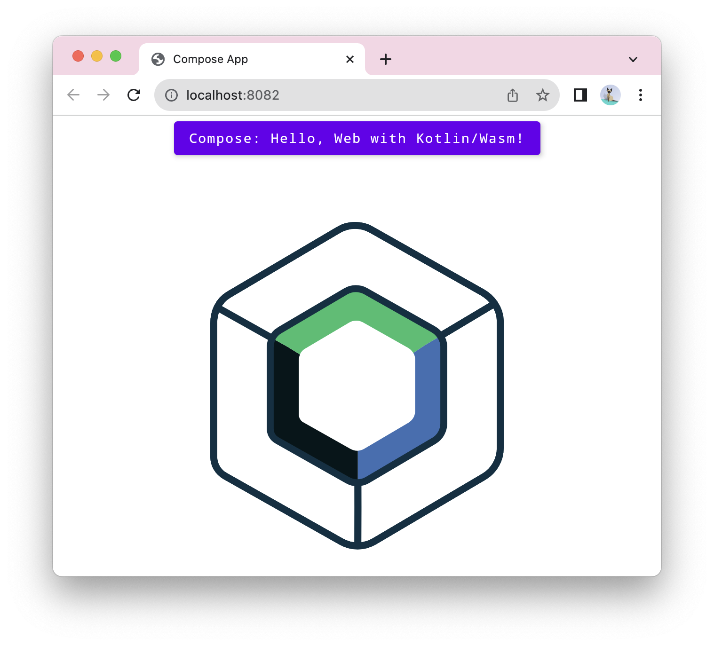

This example showcases a web application built with [Compose Multiplatform for web](#compose-multiplatform-for-web) and [Kotlin/Wasm](https://kotl.in/wasm).

Check it out:

## Compose Multiplatform for web

> **Note:**
> Web support is in [Beta](https://kotlinlang.org/docs/components-stability.html). You can use it in production, but some APIs may still change.
> We would appreciate your feedback on [GitHub](https://github.com/JetBrains/compose-multiplatform/issues).
>
> [Join the compose-web community](https://slack-chats.kotlinlang.org/c/compose-web).

Compose Multiplatform for web enables sharing your mobile or desktop UIs on the web.

Compose Multiplatform for web is based on [Kotlin/Wasm](https://kotl.in/wasm), the newest target for Kotlin Multiplatform projects.
It lets you run your code in the browser, taking advantage of WebAssembly's high and consistent application performance.

Follow the instructions in the sections below to try out this application built with Compose Multiplatform for web and Kotlin/Wasm.

## Set up the environment

Before starting, ensure you have the necessary IDE and browser setup to run the application.

### IDE

We recommend using the latest version of [IntelliJ IDEA](https://www.jetbrains.com/idea/) (2026.2
or later) to work with the project.

To debug Kotlin/Wasm code in IntelliJ IDEA, you must have the JavaScript Debugger plugin installed.
[See more information about the plugin and how to install it.](https://www.jetbrains.com/help/idea/debugging-javascript-in-chrome.html#ws_js_debugging_chrome_before_you_start)

### Browser (for Kotlin/Wasm target)

To run applications built with Kotlin/Wasm in a browser, you need a browser supporting the [Wasm Garbage Collection (GC) feature](https://github.com/WebAssembly/gc):

**Chrome and Chromium-based**

* **For version 119 or later:**

  Works by default.

**Firefox**

* **For version 120 or later:**

  Works by default.

**Safari/WebKit**

* **For version 18.2 or later:**

  Works by default.

> **Note:**
> For more information about the browser versions, see the [Troubleshooting documentation](https://kotl.in/wasm_help/).

## Build and run

To build and run the application:

1. In IntelliJ IDEA, open the repository.
2. Run the application using one of the following options:

* **Web app:**

  `./gradlew :webApp:wasmJsBrowserProductionRun`
   &nbsp; 

* **Desktop app:**

  `./gradlew :desktopApp:run`
   &nbsp; 

* **Android app:**

  `./gradlew :androidApp:assembleDebug`
   &nbsp; 

* **iOS app:**

  Open the [/iosApp](./iosApp) directory in Xcode and run it from there, or use the `iosApp` run configuration in your IDE.

### Running tests

Use the run button in your IDE's editor gutter, or run tests using Gradle tasks:

- Android tests: `./gradlew :shared:testAndroidHostTest`
- Desktop tests: `./gradlew :shared:jvmTest`
- Web wasm tests: `./gradlew :shared:wasmJsTest`
- iOS tests: `./gradlew :shared:iosSimulatorArm64Test`

## Feedback and questions

Give it a try and share your feedback or questions in our [#compose-web](https://slack-chats.kotlinlang.org/c/compose-web) Slack channel.
[Get a Slack invite](https://surveys.jetbrains.com/s3/kotlin-slack-sign-up).
You can also share your comments with [@bashorov](https://twitter.com/bashorov) on X (Twitter).

## Learn more

* [Kotlin Multiplatform](https://www.jetbrains.com/help/kotlin-multiplatform-dev/get-started.html)
* [Compose Multiplatform](https://kotlinlang.org/compose-multiplatform/)
* [Kotlin/Wasm](https://kotl.in/wasm/)
* [Other Kotlin/Wasm examples](https://github.com/Kotlin/kotlin-wasm-examples/tree/main)
